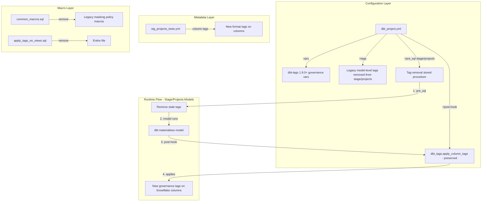

# Design Document: dbt-tags Governance Migration

## Overview

This design covers the migration of the PEXA Exchange Data Platform from legacy PI tagging (`pi_*` format) to the new dbt-tags 1.9.0+ governance format (`secure_field=VALUE` / `variant_mask=VALUE`). The migration covers the entire repository across all layers:

1. **Tag format conversion** in all 18 Model_YML files across Raw, Stage, Curate, and Data Services layers
2. **dbt-tags governance variable configuration** in `dbt_project.yml`
3. **Project-level pre-hook** for tag removal (`STRIP_COLUMN_TAGS`) applied to all models
4. **Removal of model-level `+tags`** from `dbt_project.yml` (e.g. `data_services.exchange.+tags`)
5. **Legacy macro removal** from `macros/common_macros.sql` and `macros/apply_tags_on_views.sql`

The existing `dbt_tags.apply_column_tags()` post-hook remains untouched. Tag consistency across lineage layers is enforced — if a column has PI tags in data_services, the corresponding stage and curate models must also have matching tags.

### Tag Mapping Rules

| Legacy Tag | New Tag(s) |
|---|---|
| `pi_multi` | `secure_field=PI_MULTI` + `variant_mask=TRAVERSE_VALUE_MASK` |
| `pi_email` | `secure_field=PI_EMAIL` |
| `pi_userid` | `secure_field=PI_USERID` |
| `pi_free_text_field` | `secure_field=PI_FREE_TEXT_FIELD` |
| `pi_full_name` | `secure_field=PI_FULL_NAME` |
| `pi_name` | `secure_field=PI_NAME` |
| `pi_business_name` | `secure_field=PI_BUSINESS_NAME` |
| `pi_sensitive` | `secure_field=PI_SENSITIVE` |
| All other `pi_*` types | `secure_field=<UPPER_CASE_WITHOUT_PI_PREFIX>` |

For model-level tags in `dbt_project.yml`, the same mapping applies but the source values are already UPPER CASE (e.g. `PI_BUSINESS_NAME` → `secure_field=PI_BUSINESS_NAME`, `PI_MULTI` → `secure_field=PI_MULTI` + `variant_mask=TRAVERSE_VALUE_MASK`).

## Architecture

The migration operates entirely within the dbt configuration and metadata layer — no SQL model logic changes are required. The architecture remains the existing Medallion pattern (Raw → Stage → Curate → Data Services) with Snowflake as the warehouse.



### Execution Order During Stage/Projects Model Build

1. `+pre_sql` executes the tag removal stored procedure (cleans stale tags from the model)
2. dbt materialises the model (table/view/incremental)
3. `+post-hook` calls `dbt_tags.apply_column_tags()` which reads the new-format tags from YML metadata and applies them to Snowflake columns

### Key Design Decision: `apply_tags_on_views.sql` Removal

The `apply_tags_on_views` macro is a local override that dispatches to `dbt_tags.apply_tags_on_views`. Under dbt-tags 1.9.0+, the `apply_column_tags()` post-hook handles both tables and views natively using the new governance format. The local dispatch macro is therefore redundant and should be removed entirely. The `dbt_tags` package's built-in implementation will handle view tag application.

## Components and Interfaces

### Component 1: dbt-tags Package Dependency (Requirement 1)

The `pexa-one-data-au-dbt-common-lib` git package is the sole mechanism for pulling in `dbt_tags`. The Common_Lib must supply dbt-tags >= 1.9.0. If it does not, a direct dependency must be added to `packages.yml`.

**Interface**: `packages.yml` → `dbt deps` resolution

**Action**: Verify Common_Lib provides dbt-tags 1.9.0+. If not, add:
```yaml
  - package: dbt-labs/dbt_tags
    version: [">=1.9.0", "<2.0.0"]
```

### Component 2: Governance Variables (Requirement 2)

Three new variables added to the `vars:` block in `dbt_project.yml`:

```yaml
vars:
    # ... existing vars preserved ...
    dbt_tags__opt_in_default_naming_config: false
    dbt_tags__allowed_tags: ["secure_field", "variant_mask"]
    dbt_tags__tag_name_separator: "="
```

**Interface**: dbt-tags reads these variables at compile time to validate and parse tag names.

**Constraint**: Existing `dbt_tags__database`, `dbt_tags__schema`, and `dbt_tags__resource_types` variables must remain unchanged.

### Component 3: Column-Level Tag Migration (Requirement 3)

All 18 Model_YML files across all layers (Raw, Stage, Curate, Data Services) are converted in-place. The YAML structure is preserved — tags remain directly under columns (not nested under `config:`).

**Files to convert:**
- `models/raw/api_logs/api_logs.yml`
- `models/raw/api_logs/raw_sources.yml`
- `models/raw/exchange/exchange_external_tables.yml`
- `models/raw/exchange/mat_views/raw_exchange_matviews.yml`
- `models/raw/pexakey/pexakey.yml`
- `models/raw/projects/projects_external_tables.yml`
- `models/stage/exchange/stg_tests.yml`
- `models/stage/projects/stg_projects_tests.yml` (already converted)
- `models/curate/api_logs/api_logs_curate_views.yml`
- `models/curate/exchange/exchange_curate.yml`
- `models/curate/pexakey/curate_pexakey.yml`
- `models/curate/projects/projects_curate.yml`
- `models/data_services/api_logs/api_logs_data_services.yml`
- `models/data_services/api_push_notification/current/ds_api_push_notification.yml`
- `models/data_services/exchange/active/ds_exchange_views.yml`
- `models/data_services/exchange/exchange_data_services.yml`
- `models/data_services/pexakey/dataservices_pexakey.yml`
- `models/data_services/projects/projects_data_services.yml`

**Before**:
```yaml
      - name: data
        tags:
          - pi_multi
```

**After**:
```yaml
      - name: data
        tags:
          - secure_field=PI_MULTI
          - variant_mask=TRAVERSE_VALUE_MASK
```

**Before**:
```yaml
      - name: email
        tags:
          - pi_email
```

**After**:
```yaml
      - name: email
        tags:
          - secure_field=PI_EMAIL
```

**Tag inventory in `stg_projects_tests.yml`**:
- `pi_email` (14 occurrences) → `secure_field=PI_EMAIL`
- `pi_multi` (14 occurrences) → `secure_field=PI_MULTI` + `variant_mask=TRAVERSE_VALUE_MASK`
- `pi_userid` (3 occurrences) → `secure_field=PI_USERID`
- `pi_free_text_field` (3 occurrences) → `secure_field=PI_FREE_TEXT_FIELD`
- `pi_full_name` (2 occurrences) → `secure_field=PI_FULL_NAME`
- `pi_name` (2 occurrences) → `secure_field=PI_NAME`
- `pi_business_name` (1 occurrence) → `secure_field=PI_BUSINESS_NAME`
- `pi_sensitive` (1 occurrence) → `secure_field=PI_SENSITIVE`

### Component 4: Remove Model-Level Tags (Requirement 4)

File: `dbt_project.yml`

All `+tags` lists under any model section are removed entirely. Tag governance is managed exclusively through column-level tags in Model_YML files.

**Action**: Remove the `+tags` block under `data_services.exchange` (14 legacy PI tags). Do not add replacement tags — column-level tags in the Model_YML files are the single source of truth.

### Component 5: Tag Removal Pre-Hook at Project Level (Requirement 5)

A `+pre-hook` is added at the top `models.pexa_one_data_au_exchange_dbt` level in `dbt_project.yml` to execute the tag removal stored procedure before each model build across all layers.

```yaml
models:
  pexa_one_data_au_exchange_dbt:
    +pre-hook:
      - "CALL {{ env_var('DBT_GOVERNANCE_DB') }}.{{ env_var('DBT_GOVERNANCE_SCHEMA') }}.STRIP_COLUMN_TAGS('{{ this.database }}', '{{ this.schema }}', '{{ this.name }}')"
    +post-hook:
      - >
        
          {{ dbt_tags.apply_column_tags() }}
        
```

**Scope**: All models across all layers — not scoped to individual paths.

**Note**: Uses `+pre-hook` (not `+pre_sql`) because `{{ this }}` is only available in hook context.

**Constraint**: The `STRIP_COLUMN_TAGS` stored procedure must already exist in the governance schema. It is not created as part of this migration.

**Interface**: The stored procedure accepts three parameters: database name, schema name, and model name — all derived from `{{ this }}` context at runtime.

### Component 6: Legacy Macro Removal (Requirement 6)

File: `macros/common_macros.sql`

**Macros to remove** (16 macro definitions):
- `create_masking_policy__pi_sensitive_financial`
- `create_masking_policy__pi_full_address`
- `create_masking_policy__pi_partial_address`
- `create_masking_policy__pi_business_name`
- `create_masking_policy__pi_name`
- `create_masking_policy__pi_full_name`
- `create_masking_policy__pi_sensitive`
- `create_masking_policy__pi_contact_number`
- `create_masking_policy__pi_fax`
- `create_masking_policy__pi_free_text_field`
- `create_masking_policy__pi_flag_sensitive`
- `create_masking_policy__pi_userid`
- `create_masking_policy__pi_dob`
- `create_masking_policy__pi_email`
- `create_masking_policy__pi_multi`
- `create_additional_masking_policies_and_tags`
- `tag_PI_table`
- `apply_tags_to_source`

**Macros to preserve**:
- `generate_schema_name`
- `get_list_of_tables_to_log`
- `get_objects_to_unload`
- `column_count_check`
- `materialized_view`
- `stored_proc`
- `is_newer`

### Component 7: apply_tags_on_views Removal (Requirement 7)

File: `macros/apply_tags_on_views.sql` — **remove entirely**.

The macro is a local dispatch override for `dbt_tags.apply_tags_on_views`. Under dbt-tags 1.9.0+, the package's built-in `apply_column_tags()` post-hook handles views natively with the new tag format. The local override uses the old tag parsing logic and would conflict with the new governance format.

### Component 8: Post-Hook Preservation (Requirement 9)

The existing post-hook in `dbt_project.yml` is left completely unchanged:

```yaml
    +post-hook:
      - >
        
          {{ dbt_tags.apply_column_tags() }}
        
```

No modifications needed. The `apply_column_tags()` macro from dbt-tags 1.9.0+ reads the new governance variables and applies tags in the new format.

## Data Models

This migration does not alter any SQL data models or their materialisation strategies. The changes are purely in the metadata/configuration layer:

### Affected Configuration Files

| File | Change Type | Scope |
|---|---|---|
| `dbt_project.yml` | Add governance vars, remove `+tags`, add project-level `+pre-hook` | Project-wide |
| `models/**/*.yml` (18 files) | Convert column-level tags | All layers: Raw, Stage, Curate, Data Services |
| `macros/common_macros.sql` | Remove 18 legacy macros | Project-wide |
| `macros/apply_tags_on_views.sql` | Delete file | Project-wide |
| `packages.yml` | Potentially add direct dbt-tags dep | Project-wide |

### Tag Format Data Model

```
Legacy format:  <pi_type>           e.g. pi_email, pi_multi
New format:     <allowed_tag>=<VALUE>  e.g. secure_field=PI_EMAIL, variant_mask=PI_MULTI

Allowed tags:   secure_field, variant_mask
Separator:      =
Value format:   UPPER_CASE (legacy name without pi_ prefix, uppercased)
Special case:   pi_multi → secure_field=PI_MULTI + variant_mask=TRAVERSE_VALUE_MASK (dual tags for variant/JSON columns)
```

### Models with PI Tags in stg_projects_tests.yml

| Model | Columns with Tags | Tag Types Used |
|---|---|---|
| stg_api_usage_audit | email | pi_email |
| stg_batch_job | user_id, created_by, last_modified_by | pi_userid, pi_email |
| stg_common_data_change_job_item | data | pi_multi |
| stg_data_change_alert | subscriber_reference, change_from, change_to | pi_free_text_field, pi_full_name |
| stg_document_job_item | data | pi_multi |
| stg_financial_accounts_audit | user_id, before_description, after_description | pi_userid, pi_free_text_field |
| stg_financials_job_item | data | pi_multi |
| stg_invitation_job_item | data | pi_multi |
| stg_mot_project | account_details_data, created_by, last_modified_by | pi_multi, pi_email |
| stg_pd_user | email, first_name, last_name, subscriber_name, type, created_by, last_modified_by | pi_email, pi_name, pi_business_name, pi_sensitive |
| stg_project | data, account_details_data, created_by, last_modified_by | pi_multi, pi_email |
| stg_report_audit | username | pi_email |
| stg_settlement_job_item | data | pi_multi |
| stg_transfer_job_item | data | pi_multi |
| stg_upload_file | file_content, mapped_content, user_id, created_by, last_modified_by | pi_multi, pi_userid, pi_email |
| stg_upload_job_item | data | pi_multi |
| stg_upload_job_items | data | pi_multi |
| stg_workspace | data, modified_by_ip, created_by, last_modified_by | pi_multi, pi_email |
| stg_workspace_update_parent_title_job_item | data | pi_multi |


## Correctness Properties

*A property is a characteristic or behavior that should hold true across all valid executions of a system — essentially, a formal statement about what the system should do. Properties serve as the bridge between human-readable specifications and machine-verifiable correctness guarantees.*

### Property 1: Tag conversion round-trip

*For any* legacy PI tag (whether lowercase `pi_*` from YML columns or UPPER CASE `PI_*` from `dbt_project.yml` `+tags`), converting it to the new governance format and then extracting the PI classification type from the result should recover the original PI type. Specifically: for `pi_multi`/`PI_MULTI` the result must include both `secure_field=PI_MULTI` and `variant_mask=TRAVERSE_VALUE_MASK`, and for all other `pi_<type>`/`PI_<TYPE>` tags the result must be `secure_field=PI_<TYPE>` where `<TYPE>` is the original type in UPPER CASE.

**Validates: Requirements 3.1, 3.2**

### Property 2: Converted tag format validation

*For any* tag produced by the migration conversion function, the tag must match the pattern `<allowed_tag>=<VALUE>` where `<allowed_tag>` is one of `secure_field` or `variant_mask` (lowercase), the separator is exactly `=`, and `<VALUE>` is entirely UPPER CASE with no whitespace.

**Validates: Requirements 3.4, 3.5**

### Property 3: No legacy column-level tags remain

*For any* YAML file under the `models/` directory, after migration there should be zero tag entries matching the legacy `pi_` prefix pattern (case-insensitive) in column-level `tags:` lists.

**Validates: Requirements 3.3, 8.1**

### Property 4: No legacy masking policy macros remain

*For any* file in the `macros/` directory, after migration there should be zero Jinja macro definitions whose name matches the pattern `create_masking_policy__*`.

**Validates: Requirements 6.1, 8.3**

### Property 5: Non-masking macros preserved

*For any* macro in the preserved set (`generate_schema_name`, `get_list_of_tables_to_log`, `get_objects_to_unload`, `column_count_check`, `materialized_view`, `stored_proc`, `is_newer`), the macro definition must still exist in `macros/common_macros.sql` after migration.

**Validates: Requirements 6.5**

## Error Handling

### Compilation Errors

If `dbt compile` fails after migration, the most likely causes are:

1. **Missing dbt-tags 1.9.0+**: The governance variables (`dbt_tags__allowed_tags`, etc.) are not recognized by older versions. Resolution: verify Common_Lib provides >= 1.9.0 or add direct dependency.
2. **Invalid tag format**: A tag not matching `<allowed_tag>=<VALUE>` will be rejected by dbt-tags validation. Resolution: re-run the tag conversion and verify all tags match the expected pattern.
3. **Broken macro references**: If any model or test references a removed masking policy macro, compilation will fail. Resolution: search for references to removed macros before deletion.

### Tag Application Failures

If `dbt_tags.apply_column_tags()` fails at runtime:

1. **Stale tags**: The `+pre_sql` stored procedure should clean these up for stage/projects models. If the stored procedure doesn't exist in the governance schema, the pre_sql will fail. Resolution: ensure the `REMOVE_STALE_TAGS` stored procedure is deployed before running dbt.
2. **Permission errors**: The dbt service account must have `APPLY TAG` privileges on the governance database/schema. Resolution: verify Snowflake RBAC grants.

### Rollback Strategy

All changes are configuration-only and version-controlled in Git. Rollback is a simple `git revert` of the migration commit. No data migration or Snowflake DDL changes are involved in the dbt project itself.

## Testing Strategy

### Dual Testing Approach

Both unit tests and property-based tests are used. Unit tests verify specific examples and edge cases. Property-based tests verify universal properties across generated inputs.

### Property-Based Testing

**Library**: [Hypothesis](https://hypothesis.readthedocs.io/) (Python) for testing the tag conversion logic.

The tag conversion function is a pure string transformation that can be extracted and tested independently of dbt. A small Python module implementing the conversion rules will be tested with Hypothesis.

**Configuration**: Minimum 100 iterations per property test.

Each property test must reference its design document property with a comment tag:
- `# Feature: dbt-tags-governance-migration, Property 1: Tag conversion round-trip`
- `# Feature: dbt-tags-governance-migration, Property 2: Converted tag format validation`

Each correctness property is implemented by a single property-based test.

### Unit Tests

Unit tests focus on:

1. **Specific tag conversion examples**: Each of the 8 PI tag types in scope, verifying exact output strings
2. **Edge cases**: Empty string input, tags with extra whitespace, tags not in the PI set, mixed-case input
3. **YAML structure validation**: Verify `stg_projects_tests.yml` parses correctly after migration and tags are at the correct nesting level
4. **Config validation**: Verify `dbt_project.yml` contains the three new governance variables with correct values
5. **Macro removal validation**: Verify `common_macros.sql` no longer contains any of the 18 removed macros but retains all 7 preserved macros
6. **File deletion validation**: Verify `macros/apply_tags_on_views.sql` no longer exists
7. **Post-hook preservation**: Verify the `apply_column_tags()` post-hook is unchanged

### Integration Tests

- `dbt compile` must succeed after all changes (Requirement 10.1)
- `dbt test` must pass all existing tests (Requirement 10.2)
- These are run in CI as part of the PR validation pipeline

### Validation Script

A Python validation script scans the project post-migration to confirm:
- Zero `pi_` prefix tags in any `models/**/*.yml` file
- Zero `PI_` prefix tags without `=` separator in `dbt_project.yml` `+tags` lists
- Zero `create_masking_policy__` macro definitions in `macros/`
- Presence of all three governance variables in `dbt_project.yml`
- Presence of the `apply_column_tags()` post-hook
